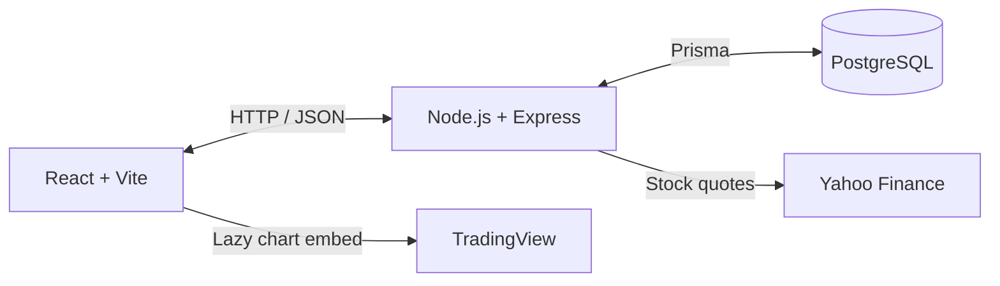

# ThesisHub

**Share an investment thesis. Explain your conviction. Challenge the assumptions.**

[](https://github.com/ReyA44/thesis-hub/actions/workflows/ci.yml)

ThesisHub is a full-stack, **local-first investment discussion app**. Instead of posting a ticker and a prediction, members publish structured investment arguments with a conviction level, supporting reasoning, risks and conditions that could invalidate the idea. Others can react, discuss and revisit the thesis alongside market context.

**Status:** Functional educational MVP · **Hosting:** Local only; no public demo URL yet · **Brokerage integration:** None

## What you can do

- **Publish and manage theses** — Title, 1–10 tickers, required conviction, and optional price target, horizon, catalysts, risks, strategy and counter-thesis. Only the author can edit or delete a post.
- **Explore the public feed** — Search by ticker/company or author; filter by conviction, sentiment and age; sort by newest, oldest, popular or discussed.
- **Discuss ideas** — Five sentiment reactions and one editable text reply per user per post, with publicly visible reply edit history.
- **Review market context** — Last available price through an unofficial Yahoo Finance integration, optional publication-price snapshot and performance comparison, and a TradingView chart that loads only when opened.

Guests can read. Registering and signing in is required to publish or interact.

## How it's built



| Part | Technology | Why it is here |
|---|---|---|
| Frontend | React 19, Vite, plain CSS | Components, forms and feed interactions without a UI framework |
| Backend | Node.js, Express 5 | REST API, validation, authentication and authorization |
| Database | PostgreSQL 17, Prisma 6 | Related records, constraints, migrations and transactional edits |
| Authentication | bcrypt, JWT | Password hashes and authenticated API requests |
| External market services | yahoo-finance2, TradingView widget | Quote context and embedded charts |
| Verification | Node built-in test runner, GitHub Actions | Unit tests, real HTTP/PostgreSQL integration tests, frontend lint and build |

### Engineering decisions worth exploring

- **Permissions enforced server-side:** JWT authentication and ownership checks; database uniqueness enforces one reaction and one reply per user per thesis.
- **Consistent history:** Reply edits store the previous text and update the current reply in one Prisma transaction.
- **Market data is optional:** An unavailable quote does not block publication. A publication-price snapshot is captured only when a usable quote is available; changing the primary ticker invalidates the old snapshot.
- **Small, explainable architecture:** One React client, one Express API, one PostgreSQL database; no microservices, state-management framework or additional UI library.
- **Automated quality checks:** Every PR runs backend unit tests, HTTP tests against disposable PostgreSQL, ESLint and the frontend production build.

For the detailed data model and request flows, see [architecture](docs/architecture.md).

## Run locally

**Requires:** Node.js 22+, npm, Docker and Docker Compose.

1. Clone the repository and configure the backend:
   ```bash
   git clone https://github.com/ReyA44/thesis-hub.git
   cd thesis-hub
   cp server/.env.example server/.env
   ```
   Edit `server/.env`: use a strong random `JWT_SECRET`, change `POSTGRES_PASSWORD`, and update the password in `DATABASE_URL` to match. The local database uses port **5433**.

2. Start PostgreSQL:
   ```bash
   docker compose up -d
   ```

3. Start the API in one terminal:
   ```bash
   cd server
   npm ci
   npx prisma migrate deploy
   npm run dev
   ```

4. Start the frontend in another terminal, from the repository root:
   ```bash
   cd client
   npm ci
   npm run dev
   ```

Open **http://localhost:5173**. The API runs at **http://localhost:3000**. If the backend runs elsewhere, configure `VITE_API_URL` in `client/.env` (see `client/.env.example`). Never commit real secrets.

## Tests and verification

```bash
# From server/
npm test                   # Fast unit tests (no database)

# From client/
npm run lint
npm run build
```

The [CI workflow](.github/workflows/ci.yml) additionally runs `npm run test:integration` against a **disposable PostgreSQL database named `*_test`** with deterministic, stubbed market quotes. Refer to [testing](docs/testing.md) for the integration setup and browser walkthrough. CI passing does **not** mean every UI interaction or third-party chart has been browser-tested.

## Documentation

| Guide | Contents |
|---|---|
| [Architecture](docs/architecture.md) | Components, ER diagram, data flow and trade-offs |
| [API](docs/api.md) | Endpoints, payloads, authentication and errors |
| [Requirements](docs/requirements.md) | Delivered features and scope boundaries |
| [Authorization matrix](docs/authorization-matrix.md) | Visitor vs signed-in permissions |
| [Testing](docs/testing.md) | Automated tests and manual verification |
| [Development history](docs/development-history.md) | Project milestones with real PR references |
| [AI-assisted workflow](docs/ai-usage.md) | Development tools, decisions and verification boundaries |
| [Roadmap / backlog](docs/backlog.md) | Sharing prerequisites and deferred product features |
| [Licensing](docs/licensing.md) | Current code/license status and market-data usage considerations |

An earlier [course presentation in Hebrew](docs/THESISHUB_FINAL_PRESENTATION_HE.md) is retained as a historical project artifact, not as the authoritative current documentation.

## Scope and limitations

This is a **portfolio/educational MVP**, not a brokerage, investment-advice service or production-ready social network.

- Up to **25 posts** are returned per feed request; popularity ranks only the 200 newest matching candidates. There is no pagination yet.
- JWTs are held in browser memory: refreshing the page signs the user out. No account recovery or email verification yet.
- Price data may be delayed/unavailable. Yahoo Finance access is unofficial, and third-party licensing must be reviewed before public distribution.
- Posting, rate limiting and caches were designed for a single local backend, not a multi-instance public deployment.
- Public hosting, privacy/account-deletion workflows, moderation, backups and production monitoring are tracked in the [backlog](docs/backlog.md).
- A repository-wide source license has not yet been selected. See [licensing notes](docs/licensing.md).

**Investment posts are user opinions, not investment recommendations.**
