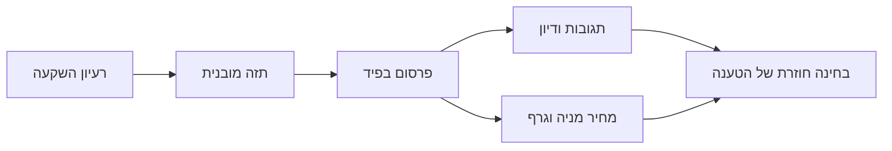
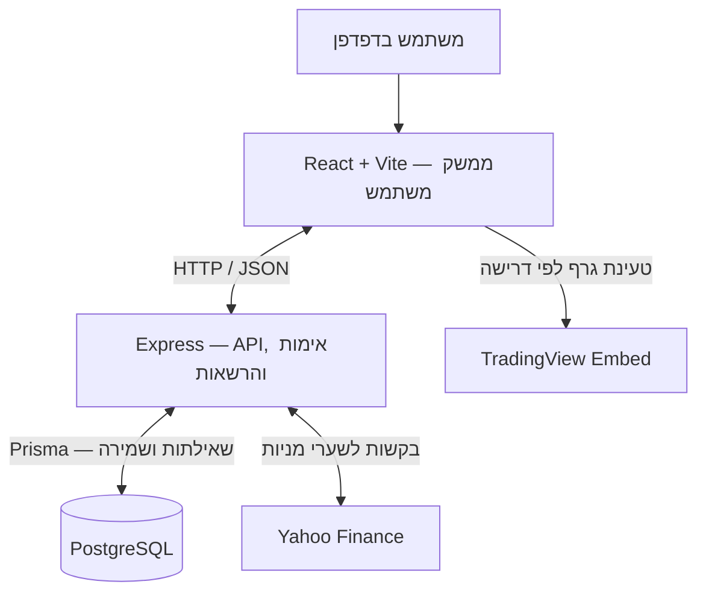
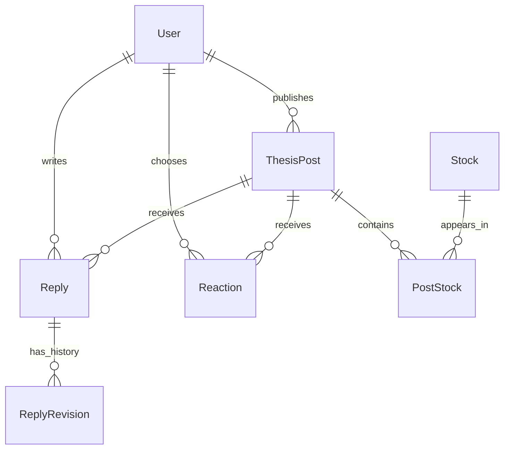

# מצגת סיום פרויקט — ThesisHub

**פרויקט Fullstack: פלטפורמה חברתית לפרסום ולדיון בתזות השקעה במניות**  
**קוד הפרויקט:** [ReyA44/thesis-hub](https://github.com/ReyA44/thesis-hub)

> המסמך מבוסס על הקוד והתיעוד בענף `master` לאחר מיזוג התיקונים ב־PR #38. קטעי ה״מה לומר״ נועדו לשמש בסיס להצגה בעל־פה. בסעיפי הלקחים מדובר בניסוח מוצע, שכדאי להתאים לחוויה האישית שלך.

---

## 1. מה תכננתי לעשות, לבנות או לפתח?

### הרעיון

רציתי לבנות **רשת חברתית ממוקדת לרעיונות השקעה**, שבה כל פרסום הוא *תזה שאפשר להבין, לדון בה ולבחון אותה לאורך זמן* — ולא רק הודעה בסגנון ״המניה הזאת תעלה״.

כל תזה אמורה לכלול כמה מרכיבים בסיסיים:

- **טענה מרכזית קצרה** — מה אני חושב שיקרה ולמה.
- **מניה או כמה מניות** — כדי לקשר את הרעיון לנכס מוגדר.
- **רמת ביטחון (Conviction)** — נמוכה, בינונית או גבוהה.
- **פרטים אופציונליים** — מחיר יעד, אופק זמן, זרזים (Catalysts), סיכונים, תנאים שיפריכו את התזה, אסטרטגיה וטיעון נגדי.
- **דיון קהילתי** — תגובות, דירוגי סנטימנט ואפשרות לערוך תגובה תוך שמירת הגרסאות הקודמות.

### המחשה: מה קורה לרעיון השקעה?



**מה לומר:**  
״המטרה שלי הייתה לתת מבנה לדיונים על מניות. במקום פרסום של תחושה כללית, המשתמש מציג טענה, רמת ביטחון והנחות. משתמשים אחרים יכולים להגיב, ובמקביל אפשר להסתכל על נתוני השוק ולראות כיצד הרעיון מתפתח. זו פלטפורמה לדיון בתזות, לא מערכת למסחר.״

**הערה לגבי Data Analysis:** הפרויקט הוא פיתוח מערכת Fullstack, ולא פרויקט מחקר של ניתוח נתונים. יש בו שימוש בנתוני שוק וחישובים פשוטים, אבל לא שאלת מחקר סטטיסטית עצמאית.

---

## 2. טכנולוגיות עיקריות

| שכבה | טכנולוגיה | התפקיד שלה בפרויקט |
|---|---|---|
| צד לקוח (Frontend) | **React 19 + Vite** | מסכים, טפסים, פיד, מצב התחברות ואינטראקציות |
| שרת (Backend) | **Node.js + Express 5** | API, אימות משתמשים, בדיקת קלט והרשאות, לוגיקה עסקית |
| מסד נתונים | **PostgreSQL 17** | שמירה קבועה של משתמשים, תזות, מניות, תגובות וריאקציות |
| גישה למסד | **Prisma 6** | הגדרת מודלים וקשרים, שאילתות, מיגרציות וטרנזקציות |
| אימות משתמשים | **bcrypt + JWT** | שמירת סיסמאות כ־Hash ואימות בקשות של משתמש מחובר |
| נתוני שוק | **yahoo-finance2** | קבלת שער מניה עדכני ככל שהמקור מאפשר, דרך השרת |
| גרפים | **TradingView Embed** | גרפים לתקופות YTD ושנה, שמוטמעים בדפדפן לפי דרישה |
| סביבת פיתוח ובדיקות | **Docker Compose, Git, GitHub Actions** | מסד נתונים מקומי, בקרת גרסאות ובדיקות אוטומטיות |

**מה לומר:**  
״הפרדתי את המערכת לשלוש שכבות: React מציג את הממשק, Express מטפל בבקשות ובלוגיקה העסקית, ו־PostgreSQL שומר את המידע. Prisma הוא הממשק בין הקוד למסד הנתונים. בנוסף יש שירותים חיצוניים למחירי מניות ולגרפים.״

---

## 3. מקורות המידע / פרויקט Open Source שהתבססתי עליו

| מקור | איזה מידע מתקבל ממנו? | כיצד השתמשתי בו? |
|---|---|---|
| **המשתמשים במערכת** | תזות, מניות, רמת ביטחון, תגובות וריאקציות | זהו **מקור המידע המרכזי** של המוצר; הנתונים נשמרים ב־PostgreSQL |
| **Yahoo Finance** דרך `yahoo-finance2` | מחיר מסחר אחרון זמין, מטבע, זמן המחיר ושם חברה | השרת מבקש שער ומציג אותו לצד תזה; משתמש בו גם לחישוב פער ממחיר יעד |
| **TradingView** | גרף שוק חיצוני | רכיב מוטמע בדפדפן; המערכת אינה מעתיקה את סדרת נתוני הגרף למסד הנתונים |

**חשוב לדייק:**

- לא התבססתי על קוד של פרויקט Open Source אחד שאותו שִכפלתי והמשכתי לפתח. השתמשתי בספריות ובכלים קיימים, כגון React, Express, Prisma ו־PostgreSQL, כדי לבנות את האפליקציה.
- החיבור ל־Yahoo Finance **אינו API רשמי של Yahoo**. המחיר יכול להיות מעוכב או לא זמין, ולכן לא מוצג כהתחייבות לשער בזמן אמת.
- מחירים נשמרים ב־**Cache בזיכרון השרת למשך עד 24 שעות**. בזמן פרסום תזה, המערכת מנסה לשמור צילום מצב של מחיר המניה הראשית; אם אין נתון מתאים, הפרסום נשמר גם בלי המחיר.

**מה לומר:**  
״המידע החברתי מגיע מהמשתמשים עצמם. נתוני השוק נמשכים משירות חיצוני, אבל דרך השרת שלי כדי לשלוט בבקשות ולשמור Cache. הגרף של TradingView נטען בצד הלקוח רק כשהמשתמש מבקש לראות אותו.״

---

## 4. ארכיטקטורת המערכת

### 4.1 הרכיבים העיקריים וכיצד הם מתקשרים



**דוגמה — משתמש מפרסם תזה:**

1. המשתמש ממלא את `ThesisForm.jsx` ב־React ולוחץ Publish.
2. React שולח `POST /api/posts` לשרת, כ־JSON ועם טוקן JWT של המשתמש.
3. Express מאמת את הטוקן, בודק את שדות התזה ומנסה לקבל מחיר למניה הראשית.
4. Prisma יוצר את התזה ואת קשריה למניות ב־PostgreSQL.
5. השרת מחזיר תשובה ל־React, והפיד נטען מחדש ומציג את התזה.

**איפה להצביע בקוד:**

- [`client/src/components/ThesisForm.jsx`](../client/src/components/ThesisForm.jsx) — בניית גוף הבקשה (`payload`) ושליחתה ב־`fetch`.
- [`server/src/routes/posts.js`](../server/src/routes/posts.js) — `POST /api/posts`, ולידציה ושמירה במסד.
- [`server/prisma/schema.prisma`](../server/prisma/schema.prisma) — מודל הנתונים.

### 4.2 כיצד המידע קשור במסד הנתונים?



**איך להסביר את התרשים:**

- `User` הוא משתמש; `ThesisPost` היא תזה שהוא פרסם.
- `Stock` היא מניה, ו־`PostStock` היא **טבלת קישור**: תזה יכולה לכלול כמה מניות, ואותה מניה יכולה להופיע בכמה תזות. המיקום הראשון (`position = 0`) מגדיר את המניה הראשית.
- `Reaction` מחברת בין משתמש לתזה ושומרת אחת מחמש תגובות סנטימנט: `ROCKET`, `BULLISH`, `NEUTRAL`, `BEARISH`, `BAG_HOLDER`.
- `Reply` היא תגובת טקסט; `ReplyRevision` שומרת גרסאות קודמות שלה.

### 4.3 קטעי קוד שכדאי להיות מוכן להציג

**א. כלל עסקי שנאכף במסד הנתונים — תגובה אחת וריאקציה אחת למשתמש בכל תזה**  
מקור: [`server/prisma/schema.prisma`](../server/prisma/schema.prisma)

```prisma
// מופיע במודל Reply
@@unique([userId, postId])

// מופיע גם במודל Reaction
@@unique([userId, postId])
```

**הסבר:** לא מסתמכים רק על הממשק כדי למנוע כפילויות. גם מסד הנתונים אוכף את הכלל. כאשר משתמש מחליף ריאקציה, מתעדכנת הרשומה הקיימת במקום להוסיף חדשה.

**ב. בדיקת הרשאות בצד השרת — רק המחבר יכול לערוך את התזה**  
מקור: [`server/src/routes/posts.js`](../server/src/routes/posts.js)

```js
if (existingPost.authorId !== req.userId) {
    return res.status(403).json({
        error: "You cannot edit another user's thesis.",
    });
}
```

**הסבר:** אחרי ש־JWT אומת, השרת יודע מי המשתמש (`req.userId`). הוא משווה אותו למחבר האמיתי של התזה במסד. **הסתרת כפתור Edit בדפדפן אינה תחליף לבדיקת הרשאות בשרת.**

**ג. שמירה אמינה של היסטוריית עריכת תגובה**  
מקור: [`server/src/routes/replies.js`](../server/src/routes/replies.js), בפעולת `PATCH`.

```js
await tx.replyRevision.create({
    data: {
        replyId: existing.id,
        content: existing.content,
    },
});

return tx.reply.update({
    where: { id: existing.id },
    data: { content },
    include: replyRelations,
});
```

**הסבר:** שתי הפעולות האלה מתבצעות בתוך **טרנזקציית Prisma**: קודם שומרים את הנוסח הקודם, ואז מעדכנים את הנוסח הנוכחי. אם הטרנזקציה נכשלת, היא מתבטלת כיחידה אחת.

**מה לומר על הארכיטקטורה:**  
״הרעיון המרכזי הוא הפרדת אחריות: React אחראי לתצוגה, Express לבדיקות ולכללי המערכת, ו־PostgreSQL לשמירה ולאכיפת אילוצים. כך משתמש לא יכול לעקוף הרשאות רק באמצעות שינוי בקשה מהדפדפן.״

---

## 5. דמו (Demo)

**כתובת האפליקציה המקומית:** <http://localhost:5173> — לאחר הפעלת PostgreSQL, השרת וה־Frontend לפי ה־[README](../README.md).

**תסריט הדגמה מומלץ — מה לעשות ומה להסביר:**

| שלב | מה להראות על המסך | מה להגיד |
|---|---|---|
| **1. הפיד הציבורי** | להיכנס בלי התחברות, לראות תזות ולחפש לפי טיקר | ״אפשר לקרוא תזות גם בלי חשבון; פרסום ואינטראקציות דורשים התחברות.״ |
| **2. הרשמה והתחברות** | להציג את מסכי Register ו־Log in ולהיכנס לחשבון | ״הסיסמה נשמרת כ־Hash, והשרת מחזיר JWT לאחר התחברות.״ |
| **3. יצירת תזה** | למלא טענה, מניה ראשית, Conviction, מחיר יעד ושדות מתקדמים | ״במקום טקסט חופשי בלבד, אני דורש כמה נתונים ומאפשר לפרט את ההנחות.״ |
| **4. תזה בפיד** | לפרסם, להרחיב פרטים מתקדמים ולפתוח גרף 1Y/YTD | ״התזה נשמרת במסד, ומידע השוק מגיע ממקור חיצוני.״ |
| **5. עריכת תזה** | לשנות שדה בתזה שלך ולשמור | ״רק המחבר יכול לבצע את הפעולה, וזה נבדק גם בשרת.״ |
| **6. חיפוש ומיון** | להחליף חיפוש/מסננים, `newest` / `popular` / `discussed` | ״אפשר למצוא תזות לפי מניה, מחבר, רמת ביטחון, סנטימנט וגיל הפרסום.״ |
| **7. ריאקציות** | לבחור ריאקציה ואז להחליף אותה באחרת | ״לכל משתמש יש לכל היותר ריאקציה אחת לכל תזה.״ |
| **8. דיון והיסטוריה** | לפרסם תגובה, לערוך אותה ולפתוח את היסטוריית הגרסאות | ״הגרסה הקודמת נשמרת במסד ונגישה לכולם.״ |
| **9. הרשאות** | לעבור לחשבון אחר ולראות שאי אפשר לערוך תזה של משתמש ראשון | ״השרת מזהה את המשתמש מהטוקן ולא סומך על זהות שנשלחת מהלקוח.״ |

### דוגמת תזה שאפשר להקליד במהלך הדמו

> **Title:** Microsoft may benefit from sustained cloud demand  
> **Ticker:** MSFT — Microsoft  
> **Conviction:** Medium  
> **Full thesis:** Continued demand for cloud services may support long-term revenue growth.  
> **Catalysts:** Cloud earnings growth  
> **Main risks:** Competition and slower enterprise spending  
> **Invalidation:** Persistent deterioration in cloud growth

*זו דוגמה סינתטית לצורך הדגמת השדות, ולא המלצת השקעה. את שדה מחיר היעד אפשר להשאיר ריק או למלא ערך לצורך הצגת חישוב הפער.*

**מה להסביר אם עולה שאלת הדירוג:**  
מיון `popular` מבוסס על הנוסחה `מספר ריאקציות + 5 × מספר תגובות טקסט`. לשם פשטות ה־MVP, החישוב מתבצע על עד 200 התזות האחרונות שעונות למסננים, והפיד מציג עד 25 תוצאות.

**מה להסביר אם מחיר לא נטען:**  
״השירות החיצוני עשוי לא לענות. המשתמש עדיין יכול לפרסם תזה; הנתון הפיננסי הוא תוספת לתוכן, ולא תלות שמונעת שימוש במערכת.״

**שימו לב:** לפי [מסמך הבדיקות](testing.md), בדיקת הקבלה הידנית בדפדפן עדיין צריכה להתבצע לפני ההצגה. מעבר בדיקות אוטומטיות ב־GitHub לא מוכיח שכל פעולת UI נבדקה ידנית.

---

## 6. פערים בין התכנון לביצוע

### מה היה בתכנון הרחב, אבל לא מומש ב־MVP?

| רכיב שתוכנן / נשקל | מה מצב הביצוע? |
|---|---|
| **תגיות (Tags) ומסננים לפי תגיות** | לא מומש; קיימים מסננים לפי מניה, מחבר, Conviction, סנטימנט וזמן |
| **קישורים מובנים למקורות שתומכים בתזה** | לא מומש כישות או כמנגנון ייעודי |
| **סינון לפי פער ממחיר היעד** | החישוב וההצגה קיימים; סינון התזות לפי הפער לא מומש |
| **עמוד ייעודי לכל תזה** | הפרטים והדיונים מוצגים בתוך הפיד עצמו |
| **דפדוף מלא (Pagination) בפיד** | קיימת מגבלת תוצאות מכוונת לגרסת ה־MVP |
| **פריסה ציבורית באינטרנט** | לא בוצעה; הוגדר שההגשה תהיה מערכת מקומית |

**מה לומר:**  
״התחלתי מרעיון רחב יותר, אבל במהלך הבנייה הגדרתי גרסת MVP מצומצמת יותר. העדפתי להשלים זרימה מקצה לקצה — משתמש, תזה, מידע שוק ודיון — במקום להתחיל הרבה פיצ'רים שלא אספיק להשלים.״

### מה נוסף או קיבל דגש במהלך הפיתוח מעבר לרעיון הראשוני?

- **צילום מחיר בעת פרסום** (`priceAtPublication`, `priceCapturedAt`) וחישוב שינוי מאז הפרסום, כשיש נתון מתאים.
- **שמירה אמינה של גרסאות קודמות לתגובות** באמצעות טרנזקציות במסד.
- **שכבת אמינות ובדיקות**: בדיקות יחידה, בדיקות אינטגרציה מול HTTP ו־PostgreSQL, GitHub Actions, לוגים עם `Request ID`, טיפול בשגיאות ו־Rate Limiting בסיסי.

**דוגמה מוחשית לשיפור שהתגלה במהלך הפיתוח:**  
בבדיקת הקוד התגלה שאם משנים את המניה הראשית של תזה, אסור להמשיך להשוות אותה למחיר ההיסטורי של המניה הקודמת. בוצע תיקון שמאפס את צילום המחיר כשהטיקר הראשי משתנה, ונוספה בדיקת רגרסיה לכך. אפשר להצביע על [`server/src/routes/posts.js`](../server/src/routes/posts.js) ועל [PR #38](https://github.com/ReyA44/thesis-hub/pull/38).

---

## 7. לקחים עיקריים — מה הייתי עושה אחרת אם הייתי מתחיל מחדש?

*אלה נקודות מוצעות להצגה בגוף ראשון, המבוססות על מה שקרה בפרויקט. כדאי להשאיר רק את מה שמתאר באמת את צורת העבודה שלך.*

**1. הייתי מגדיר מוקדם יותר את הגבול בין ״חובה ל־MVP״ לבין ״אפשר להוסיף אחר כך״.**  
היו הרבה רעיונות טבעיים להרחבה: תגיות, מקורות, דפי פרופיל, סינון לפי מחיר יעד ועוד. הגדרה קשיחה יותר של היקף העבודה מלכתחילה הייתה מקטינה החלטות ושינויים תוך כדי הפיתוח.

**2. הייתי מתכנן מוקדם יותר את מחזור החיים של נתונים — לא רק את הטפסים.**  
לדוגמה, מחיר מניה שנשמר בזמן פרסום שייך *למניה מסוימת*. אם עורכים את התזה ומשנים את המניה הראשית, צריך להחליט במפורש מה קורה לנתון ההיסטורי. תיקון כזה קטן מלמד שצריך לחשוב מראש על ההשלכות של עריכה ומחיקה, ולא רק על יצירת הרשומה.

**3. הייתי מוסיף בדיקות אוטומטיות מוקדם יותר, יחד עם הפיתוח של כל פיצ'ר.**  
בשלבים המאוחרים נוספו בדיקות אינטגרציה ו־CI שבודקים את המערכת מקצה לקצה. אילו היו קיימים כבר בשלבים הראשונים, היה קל יותר לזהות שינויים ששוברים פונקציונליות קיימת.

**משפט מסכם להצגה:**  
״בדיעבד, הדבר החשוב ביותר שהייתי משנה הוא לא בחירה של ספרייה אחרת, אלא סדר העבודה: קודם גבולות ברורים, אחר כך מודל נתונים והתנהגות במקרה של עריכה, ולצידם בדיקות לאורך הדרך.״

---

## 8. שלושה דברים שלמדתי במהלך הפרויקט

### 1. איך מחברים מערכת Fullstack מקצה לקצה

הבנתי בצורה מעשית איך פעולה בדפדפן הופכת לבקשת HTTP, איך Express מאמת ומעבד אותה, איך Prisma שומר נתונים ב־PostgreSQL ואיך התוצאה חוזרת ל־React. למדתי גם להבחין בין **Authentication** (מי המשתמש?) ל־**Authorization** (מה מותר לו לעשות?).

### 2. איך מתכננים קשרים ואילוצים במסד נתונים רלציוני

הצורך לחבר משתמשים, תזות, מניות, ריאקציות ותגובות המחיש למה טבלאות קשר ואילוצי `UNIQUE` חשובים. למדתי שמסד הנתונים יכול — וצריך — לאכוף חלק מהכללים העסקיים, ושטרנזקציות מאפשרות לעדכן כמה רשומות באופן עקבי.

### 3. איך מנהלים שינוי תוכנה בצורה מבוקרת

עבודה עם **Git, Issues, Branches ו־Pull Requests**, יחד עם בדיקות אוטומטיות ב־**GitHub Actions**, הראתה איך לא רק כותבים פיצ'ר אלא גם מוודאים ששינוי חדש לא שובר משהו קיים. השימוש בעוזרי AI האיץ תכנון, כתיבה וביקורת קוד, אבל חידד את הצורך לבדוק את הקוד והתוצאות בפועל.

**משפט סיום אפשרי:**  
״הפרויקט לימד אותי לא רק ליצור ממשק ואפליקציה עובדת, אלא לחבר בין הדרישות, הארכיטקטורה, הנתונים, ההרשאות והבדיקות — ולהבין למה כל אחד מהם חשוב למערכת כולה.״