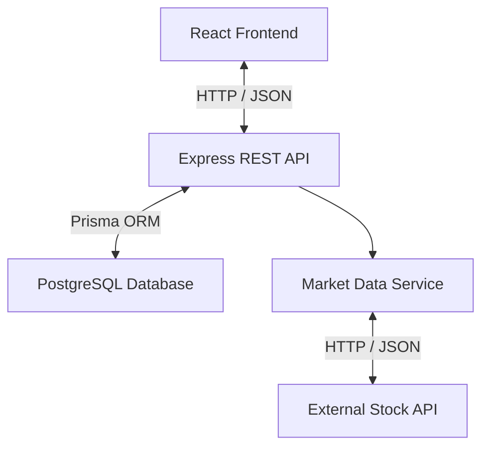
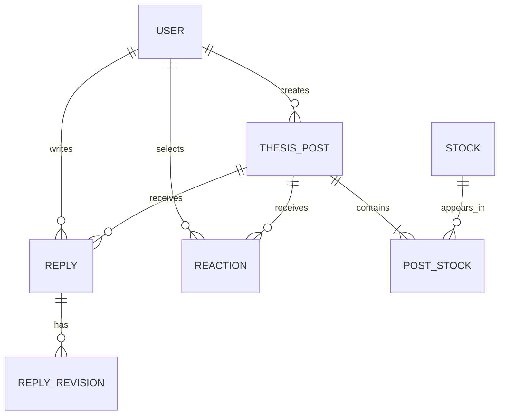
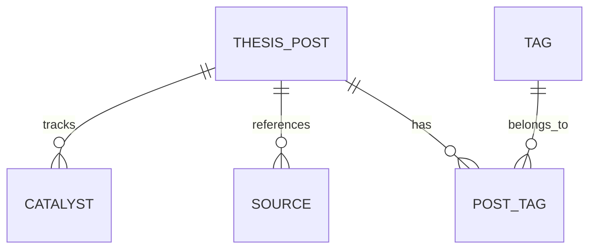

# ThesisHub — System Architecture

**Version:** 0.1
**Status:** Draft
**Related Issue:** #9

## 1. Architecture Overview

ThesisHub uses a three-tier web architecture:

1. Frontend — React + Vite
2. Backend — Node.js + Express
3. Database — PostgreSQL + Prisma

An external market-data API provides public stock prices
and historical data.

## 2. Architecture Diagram

## 3. Component Responsibilities

### Frontend — React
- Display posts, charts, comments and reactions
- Handle forms and navigation
- Communicate with the backend
- Display loading states and errors

### Backend — Express
- Expose REST API endpoints
- Handle authentication and authorization
- Validate requests
- Implement business logic
- Calculate popularity scores
- Retrieve stock data through a dedicated service

### Database — PostgreSQL + Prisma
- Store users and structured thesis posts
- Store comments and their edit history
- Store reactions and relationships between entities
- Store publication-time stock prices

### Market Data Service
- Communicate with a free external financial API
- Normalize price and historical data responses
- Handle API failures and rate limits
- Support caching to reduce API requests
- Allow switching providers without changing other components

## 4. Security Principles

- External API keys remain on the backend
- Passwords are stored as secure hashes
- Protected operations require authentication
- Users can modify only their own content
- No personal brokerage or portfolio data is collected

## 5. Pending Design

- Database entities and ERD
- REST API endpoint definitions
- Authentication flow
- Market-data provider and caching policy

## 6. Database Design

The application uses PostgreSQL with Prisma ORM.

### Entity Relationship Diagrams (ERD)

#### Core — Users, Posts and Interactions

#### Supporting Data — Tags, Catalysts and Sources

### Main Entities

| Entity | Responsibility |
|---|---|
| User | Account information and authentication |
| ThesisPost | Title, conviction, optional thesis fields, price target, publication price |
| Stock | Company name and ticker |
| PostStock | Connects posts to stocks, preserves ticker order |
| Reply | One reply per user per post |
| ReplyRevision | Stores previous reply versions and edit timestamps |
| Reaction | One reaction per user per post |
| Catalyst | Events and optional dates associated with a thesis |
| Source | Supporting links |
| Tag / PostTag | Categorization of investment theses |

### Database Constraints

- A post must have at least one associated stock.
- The first stock is the primary ticker.
- One reaction per user per post.
- One reply per user per post.
- Reply revisions preserve public edit history.
- Price targets and time horizons are optional.
- The structured price target applies only to the primary ticker.
- Publication price and its observation timestamp are stored when available.
- Ownership restrictions are enforced by the backend.

## 7. REST API Design

All backend routes begin with `/api`.

| Method | Endpoint | Purpose |
|---|---|---|
| POST | /api/auth/register | Register |
| POST | /api/auth/login | Login |
| GET | /api/posts | Public feed with filters and sorting |
| GET | /api/posts/:id | Read a post |
| POST | /api/posts | Create a post |
| PATCH | /api/posts/:id | Edit own post |
| DELETE | /api/posts/:id | Delete own post |
| PUT | /api/posts/:id/reaction | Create/change reaction |
| DELETE | /api/posts/:id/reaction | Remove reaction |
| POST | /api/posts/:id/reply | Add one reply |
| PATCH | /api/replies/:id | Edit own reply |
| DELETE | /api/replies/:id | Delete own reply |
| GET | /api/replies/:id/history | Public edit history |
| GET | /api/stocks/:ticker/quote | Latest available stock price |
| GET | /api/stocks/:ticker/history | Historical prices (YTD/1Y) |

Protected endpoints require authentication.

## 8. Authentication Flow

1. User submits registration or login information.
2. Backend validates the request.
3. Passwords are hashed and verified using bcrypt.
4. Successful login returns a signed JWT.
5. The frontend authenticates protected requests.
6. Backend middleware verifies the token.
7. Authorization checks ownership before modifying content.

Token storage and expiration policies will be finalized
during implementation.

## 9. External API Abstraction

The frontend never communicates directly with the
external financial-data provider.

The backend exposes a MarketDataService with functions:

- getCurrentPrice(ticker)
- getHistoricalPrices(ticker, period)

Responsibilities:

- Handle authentication with the provider
- Normalize API responses
- Cache responses where appropriate
- Handle rate limits and unavailable data
- Allow the provider to be replaced

The provider and caching strategy remain open decisions.

## 10. Further Design Decisions

To be finalized during implementation:

- Specific financial-data API provider
- Token storage and expiration policy
- Market-data caching and refresh intervals
- Handling deleted replies and edit history
- Exact database field types and validation rules

