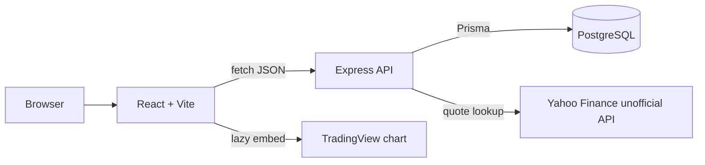
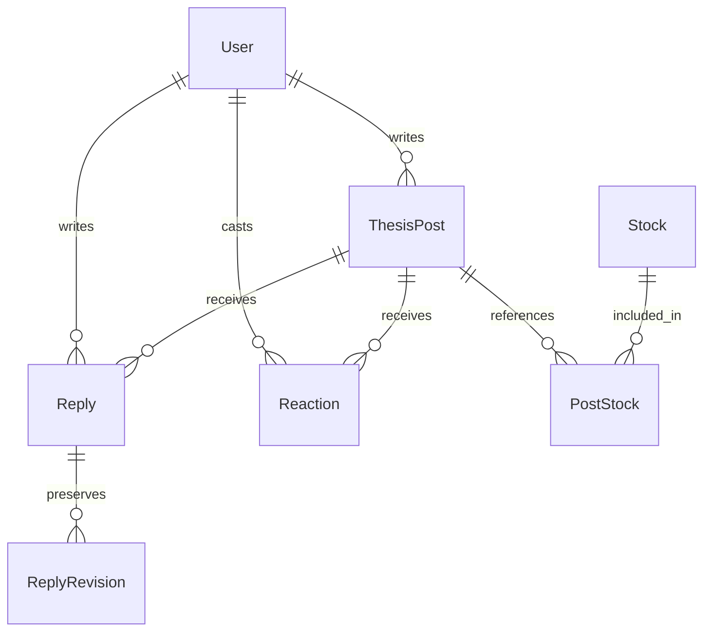

# ThesisHub — Implemented System Architecture

## Request flow

The app is intentionally a small **three-tier monolith**: React UI, one Express API, one PostgreSQL database. There is no microservice framework, message broker, Redis or authentication provider.

## Code tour

| File / folder | Responsibility |
|---|---|
| `client/src/App.jsx` | Login/register state, 2-hour JWT in memory, top-level feed/publish UI |
| `client/src/components/ThesisForm.jsx` | Create/edit forms and JSON payload |
| `client/src/components/StructuredThesisFields.jsx` | Optional thesis input fields |
| `client/src/components/StructuredThesisView.jsx` | Read-only public details |
| `client/src/components/ThesisFeed.jsx` | Feed rendering, filters, author controls |
| `client/src/components/MarketPanel.jsx` | Market quote, saved publication-price change, chart |
| `client/src/components/ReactionBar.jsx`, `ReplySection.jsx` | Social interaction UI |
| `server/src/index.js` | Read env, start server, graceful shutdown |
| `server/src/app.js` | Express middleware, endpoints, centralized JSON error responses |
| `server/src/middleware/` | JWT verification, rate limiting, request IDs and access logging |
| `server/src/routes/` | Auth, posts, market, reactions and replies HTTP logic |
| `server/src/services/discoverPosts.js` | Filtering, sort/engagement calculations |
| `server/src/utils/thesisDetails.js`, `thesisInput.js` | Shared POST/PATCH structured and core-field validation |
| `server/prisma/schema.prisma` | Database entities, types, relationships and constraints |
| `server/tests/` | Node built-in unit + HTTP integration tests |

## Actual database relationships

- `ThesisPost`: title, conviction, optional `fullThesis`, `priceTarget`, `timeHorizon`, `targetTimeframe`, `catalysts`, `invalidation`, `strategy`, `strategyReason`, `mainRisks`, `marketMissing`, `counterThesis`, and optional price snapshot.
- `Stock` + `PostStock`: many-to-many relation with ordered tickers (`position = 0` is primary). Unique constraints prevent duplicate tickers or positions per post.
- `Reply`: unique `(userId, postId)`; `ReplyRevision` stores prior text.
- `Reaction`: unique `(userId, postId)`; sentiment restricted to five enum values.
- No `Tag`, `Source` or individual `Catalyst` tables exist in this MVP.

## Request and authorization lifecycle

1. React sends a JSON request to Express.
2. `requestLogger` assigns `X-Request-ID`; middleware enforces CORS, a 64 KB body limit and rate limiting for auth/market endpoints.
3. Protected endpoints require an HS256 JWT signed with `JWT_SECRET`; its `sub` identifies the account.
4. The route validates fields; mutating routes check ownership before writes.
5. Prisma performs reads and writes; uniqueness constraints and transactions preserve reaction/reply/delete invariants.
6. Express returns a JSON result or an appropriate 4xx/5xx response; logs contain metadata but **not passwords or request bodies**.

Log line fields: `timestamp`, `level`, `event`, `requestId`, `method`, `path`, `status`, `durationMs`. Route-specific database errors are logged on the server and returned as generic client errors. Request logs are console-only; there is no persistent log storage or monitoring backend.

## Design decisions and trade-offs

1. **Relational PostgreSQL + Prisma:** foreign keys and composite unique indexes make ownership and one-reply/one-reaction rules explicit.
2. **JWT in React memory:** avoids persistent browser token storage, at the cost of logout on reload and no refresh tokens.
3. **Backend-only market quote retrieval:** centralizes third-party access and caching. The quote is an unofficial Yahoo source, cached for 24 hours in memory, with fallback to stale data where available.
4. **Publication snapshot:** at creation, attempt a fresh quote for up to 2 seconds; save the last observed regular-market quote and timestamp when available, otherwise null. Older posts are not backfilled. Current-price performance is calculated in the UI when both values exist.
5. **Lazy TradingView embed:** reduces page load and vendor work until a user explicitly opens a chart. No TradingView OHLC data is stored.
6. **Bounded feed discovery:** 25 posts returned, and popularity calculated over 200 latest matching candidates; a conscious simple MVP limitation.
7. **No additional testing framework:** Node's native test runner exercises pure logic and real HTTP/PostgreSQL on a disposable database in CI.
8. **Single-process throttling:** simple in-memory per-IP quotas suit local development, not multi-instance public hosting.

## Security and limitations

- bcrypt hashes passwords, `jsonwebtoken` signs tokens, and ownership checks run server-side.
- Malformed JSON returns 400, large JSON bodies 413 and unknown API paths 404; unexpected errors yield generic 500 responses.
- The rate limiter is not a substitute for distributed abuse protection. `CLIENT_ORIGIN` controls browser CORS, not authentication.
- Market prices may be delayed, unavailable or licensed for restricted uses. Do not treat a quote as executable trade data.
- Optional `sources`, `tags`, a hosted environment and public-market-data redistribution are outside the final local-MVP scope.
